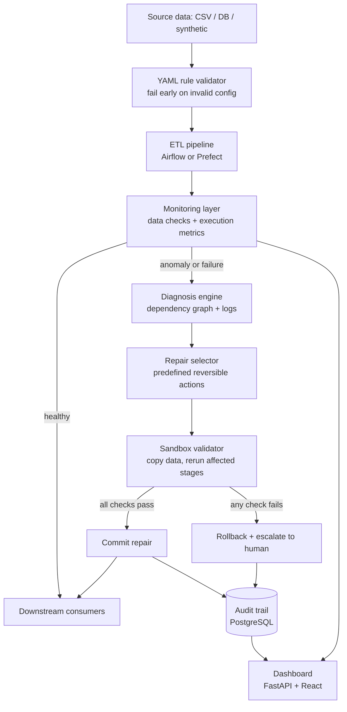

# System Architecture

## High-level flow

## Components

| Component | Responsibility |
|---|---|
| YAML rule validator | Checks schema, thresholds, and rule definitions before any pipeline runs |
| ETL pipeline | Multi-stage extract, transform, load with explicit quality gates |
| Monitoring layer | Rule-based checks and Isolation Forest on data and execution metrics |
| Diagnosis engine | Maps symptoms to root cause using the task dependency graph and logs; optional LLM explanation only |
| Repair selector | Chooses from a fixed catalogue; never executes free-form generated code |
| Sandbox validator | Applies the repair to a copy and re-runs affected downstream stages against quality rules |
| Commit / rollback | Commits only on full validation pass; otherwise restores the snapshot |
| Audit trail | Stores original data reference, diagnosis, attempted repair, validation result, outcome |
| Dashboard | Shows pipeline health, incidents, proposed repairs, and audit history |

## Safety guarantees

1. Only catalogue actions can run, and each is reversible.
2. No repair is committed without passing sandbox validation.
3. Every attempt is snapshotted and logged.
4. Uncertain or failed cases are escalated, never silently fixed.
